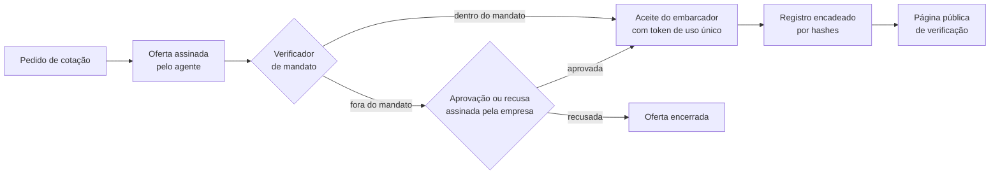

# Elo — camada de confiança entre agentes logísticos

**O problema:** Agentes de IA de frete já negociam em nome de uma empresa, mas falam
com o outro lado por canais feitos para humanos. Quando os dois lados tiverem agentes,
falta identidade verificável, um mandato que limite o que cada um pode prometer e
prova do que foi combinado.

**O que o Elo faz:**

- Dá a cada agente um certificado assinado pela empresa e um mandato com limites de valor, rotas, cargas e validade.
- Confere cada oferta assinada contra o mandato com código determinístico e manda o que sair dele para uma pessoa da empresa aprovar ou recusar, com assinatura. Isso inclui frete de carga lotação abaixo do piso mínimo da ANTT.
- Grava tudo num registro encadeado por hashes, que qualquer parte verifica sozinha numa página pública.
- Dá à transportadora um painel web em que a chave da organização é gerada e usada só no navegador, com recuperação por arquivo cifrado e frase-senha.




*Página pública de verificação: no topo, o resumo para o embarcador (valor, rota, transportadora e data do fechamento); abaixo, as 15 checagens independentes que provam o acordo (dados fictícios)*

### Rodar em 6 comandos (cmd do Windows)

```bat
git clone https://github.com/rodrigolotti/Elo.git
cd Elo
python -m venv .venv
.venv\Scripts\activate.bat
pip install pydantic cryptography pytest fastapi uvicorn httpx2 tzdata
uvicorn elo.api:app
```

Abra http://127.0.0.1:8000/painel/ para usar o painel da transportadora. Ou,
num segundo `cmd` na mesma pasta, `.venv\Scripts\activate.bat` e
`python demo_api.py`: a demo imprime o link da página de verificação.

### Limitações conhecidas

- É um protótipo com dados fictícios, não usado em produção nem validado juridicamente (a assinatura Ed25519 não é ICP-Brasil).
- O aceite do embarcador é atestado pela plataforma, não assinado por ele.
- Quem controla o banco inteiro pode reescrever a corrente (falta ancoragem externa).
- Quem tiver o arquivo de recuperação e a frase-senha toma a organização na hora: ainda não há prazo de espera para a chave antiga cancelar.
- Ainda não está pronto para a internet: `POST /pedidos` e os rascunhos não exigem autenticação.
- O piso da ANTT cobre só a Tabela A (carga lotação). Quando o agente não informa a distância, ela é estimada pelo CEP, e os CEPs vão para o ViaCEP, um serviço externo.
- O agente ainda não usa IA: as ofertas vêm de um cliente de demonstração. A extração com IA é a Fase 2.

A lista completa está em [Limitações conhecidas (honestas)](#limitações-conhecidas-honestas).

---

Núcleo da V1 (Fase 1 do roadmap). Permite que o agente de IA de uma transportadora
emita ofertas de frete **assinadas**, dentro de um **mandato** definido pela empresa,
e que o embarcador aceite. Qualquer parte consegue **verificar sozinha** o que foi
combinado. Tudo fica num registro só de inclusão, com hashes encadeados.

> Dados fictícios. Este projeto não usa nenhum dado de empregador ou cliente real.

## Como rodar

Requisitos: Python 3.11+, `pydantic` 2 e `cryptography`. Para a API, `fastapi`,
`uvicorn`, `httpx2` e `tzdata` (fusos horários da página de verificação). Para os testes, `pytest`.
Os testes do JavaScript do painel usam Node 20 ou mais novo; sem Node, eles são pulados.

```bash
python3 -m venv .venv && . .venv/bin/activate
pip install pydantic cryptography pytest fastapi uvicorn httpx2 tzdata
python3 demo.py          # cenário de ponta a ponta, com tentativa de fraude no final
python3 -m pytest -q     # 402 testes (os de JavaScript precisam de Node; o de comparação ao vivo com o esse-frete-paga só roda com ESSE_FRETE_PAGA)
```

## API no Windows (cmd)

Na pasta do projeto, num Prompt de Comando (`cmd`):

```bat
:: 1. ambiente virtual e dependências (só na primeira vez)
python -m venv .venv
.venv\Scripts\activate.bat
pip install pydantic cryptography pytest fastapi uvicorn httpx2 tzdata

:: 2. testes
python -m pytest -q

:: 3. sobe a API em http://127.0.0.1:8000 (o banco fica em elo.db)
uvicorn elo.api:app --reload
```

Para usar outro arquivo de banco, antes de subir: `set ELO_DB=C:\caminho\outro.db`.

O registro fica nesse arquivo SQLite, não só na memória: ao reiniciar a API,
organizações, mandatos, ofertas e compromissos continuam lá e verificáveis. Para
começar do zero, pare a API e apague o `elo.db`.

Com a API no ar, abra **um segundo** `cmd` na mesma pasta e rode a demo do cliente:

```bat
.venv\Scripts\activate.bat
python demo_api.py
```

Ela gera as chaves da transportadora e do agente **localmente**, cadastra tudo pela
API, emite uma oferta dentro do mandato e outra acima do limite (que passa por
aprovação), aceita as duas, revoga o mandato (mostrando que a oferta seguinte já
sai dele) e imprime no final os links, por exemplo:

```
Abra no navegador:
   http://127.0.0.1:8000/verificar/cp_cb1a583ddaa9
```

Abra esse link no navegador (ou rode `start http://127.0.0.1:8000/verificar/<id>`
no `cmd`). No topo, a página resume o frete para o embarcador (valor, rota,
transportadora e data do fechamento no horário de Brasília). Abaixo, as 15 checagens
com OK ou FALHA servem de prova. Se alguma falhar, o resumo fica vermelho e avisa para
não confiar nos dados.
A documentação interativa da API fica em http://127.0.0.1:8000/docs.
O painel da transportadora fica em http://127.0.0.1:8000/painel/ (veja abaixo).
Para parar a API, use `Ctrl+C` na janela em que ela está rodando.

### Como a API assina sem receber chave privada

Toda operação que precisa da assinatura de uma empresa tem dois passos:

1. `POST /<recurso>/rascunho`: a plataforma aplica as regras e devolve o objeto
   **sem assinatura**. O rascunho fica pendente por 10 minutos.
2. O cliente assina o rascunho do lado dele e envia o objeto assinado em
   `POST /<recurso>`. A plataforma confere a assinatura contra a chave pública
   esperada (da organização ou do agente), revalida o estado e grava no registro.
   O objeto precisa ser idêntico ao rascunho: alterar qualquer campo antes de
   assinar é recusado, e o mesmo objeto assinado não pode ser enviado duas vezes.

| Rota | O que faz | Quem assina |
| --- | --- | --- |
| `POST /organizacoes/rascunho` → `POST /organizacoes` | Cadastra a organização | a própria organização |
| `POST /agentes/rascunho` → `POST /agentes` | Emite o certificado do agente | organização |
| `POST /organizacoes/recuperacao/rascunho` → `POST /organizacoes/recuperacao` | Define ou troca a chave de recuperação | organização |
| `POST /organizacoes/rotacao/rascunho` → `POST /organizacoes/rotacao` | Troca a chave principal (sem sessão: é o caminho de quem perdeu a chave) | chave de **recuperação** |
| `POST /mandatos/rascunho` → `POST /mandatos` | Emite o mandato | organização |
| `POST /mandatos/{id}/revogacao/rascunho` → `POST /mandatos/{id}/revogacao` | Revoga o mandato | organização |
| `POST /pedidos` | Registra o pedido de cotação | ninguém |
| `POST /ofertas/rascunho` → `POST /ofertas` | Emite a oferta (diz se sai do mandato) | agente |
| `POST /ofertas/{id}/aprovacao/rascunho` → `POST /ofertas/{id}/aprovacao` | Aprovação humana | organização |
| `POST /ofertas/{id}/recusa/rascunho` → `POST /ofertas/{id}/recusa` | Recusa definitiva | organização |
| `POST /ofertas/{id}/aceite` | Aceite do embarcador por link (exige o token de aceite) | plataforma (atesta) |
| `GET /compromissos/{id}/verificacao` | Relatório em JSON | — |
| `GET /verificar/{id}` | Página pública de verificação (HTML) | — |

Erros de regra respondem 400, objetos inexistentes 404 e corpo inválido 422.

### Sessão e consultas

As consultas exigem sessão, e cada sessão só enxerga os dados da própria
organização. Não há senha: entra quem tem a chave da organização.

| Rota | O que faz |
| --- | --- |
| `POST /sessoes/desafio` | Devolve um desafio (nonce aleatório) para a organização assinar. Vale 5 minutos e uma vez só |
| `POST /sessoes` | Troca o desafio assinado pela organização por um token de sessão de 30 minutos |
| `DELETE /sessoes` | Encerra a sessão |
| `GET /organizacao`, `/agentes`, `/mandatos`, `/ofertas?status=...`, `/compromissos` | Consultas da organização logada |

O token vai no cabeçalho `Authorization: Bearer <token>`, e a API guarda só o
hash dele. Sem sessão válida, a resposta é 401. Fora as duas rotas de
verificação, nenhuma rota `GET` fica aberta, e um teste percorre todas para
garantir isso.

## Painel da transportadora

Com a API no ar, abra http://127.0.0.1:8000/painel/. É HTML, CSS e JavaScript
servidos pelo próprio FastAPI, sem framework e sem etapa de build.

**Identidade visual.** Fundo branco, uma cor de marca (azul-marinho `#0b2545`) e cor só
para status: verde para ok, âmbar para atenção, vermelho para risco. Os pares de cor do
texto passam no contraste AA da WCAG (4,5:1), conferido por teste. A fonte é a
[Inter](https://github.com/rsms/inter) (SIL Open Font License 1.1), guardada em
`elo/painel/fontes/` com a licença. Não há CDN, então a CSP só ganhou `font-src 'self'`.
Os valores usam números de largura fixa (`tabular-nums`). No celular, o topo fica em
duas linhas, o menu rola para o lado numa linha só e nenhuma tela passa da borda. O
roteiro do Chrome confere isso em 390 px.

| Tela | O que faz |
| --- | --- |
| Visão geral | Tela inicial: fretes fechados no mês, ofertas esperando decisão, fretes barrados abaixo do piso e fretes por embarcador |
| Entrar | Escolhe a organização guardada no navegador e entra assinando o desafio |
| Cadastro | Gera a chave da organização no navegador e cadastra o CNPJ |
| Agentes | Cria o certificado do agente a partir da chave pública dele |
| Mandatos | Define valor máximo, UFs, tipos de carga e validade, e revoga mandatos |
| Aprovações | Fila das ofertas fora do mandato, com o motivo de cada uma: aprovar ou recusar |
| Histórico | Compromissos firmados, com link para `/verificar/{id}` |
| Segurança | Quando o acesso e o arquivo de recuperação foram criados, histórico e "gerar novo arquivo de recuperação" (códigos técnicos em "Ver detalhes") |
| Recuperar | Troca a chave da organização com o arquivo de recuperação e a frase-senha |

**A chave da organização nunca sai do navegador.** Ela é criada com a Web Crypto
API (Ed25519) marcada como **não exportável** e guardada no IndexedDB como
`CryptoKey`: nem o painel consegue ler os bytes dela. Para o servidor vão só a
chave pública e os objetos assinados. Funciona no Chrome e no Edge 137 ou mais
novos, no Firefox 129 ou mais novo e no Safari 17 ou mais novo.

**O painel confere antes de assinar.** Cada rascunho devolvido pela API precisa
ter exatamente os campos que a pessoa escolheu (a oferta que está na tela, os
limites digitados, a chave colada). Se vier diferente, nada é assinado. Assim o
servidor não consegue fazer a organização assinar outra coisa.

**A assinatura feita no navegador bate com a do servidor.** `elo/painel/js/canonico.js`
faz a mesma canonicalização de `elo/canonico.py`. Os testes rodam esses mesmos
módulos no Node e comparam os bytes com o Python, incluindo acentos, emoji,
caracteres de controle e a ordenação por unidades UTF-16. Depois provam que
assinaturas feitas em JavaScript são aceitas pela API. Um inteiro acima de 2^53
é recusado no navegador, porque o JavaScript o arredondaria sem avisar.

### Se o navegador perder a chave: recuperação

A chave principal se perde ao limpar os dados do site, trocar de computador,
usar janela anônima ou, no Safari, ficar 7 dias sem abrir o painel. Sem ela, a
organização não cria agentes, não emite mandatos, não aprova nem recusa ofertas e
não revoga mandatos. Por isso o cadastro tem um segundo passo obrigatório.

**Chave de recuperação.** É um segundo par Ed25519 que só serve para trocar a
chave principal. No cadastro (ou na aba Segurança), o painel:

1. gera a chave de recuperação e uma **frase-senha** de 25 caracteres (125 bits),
   mostrada uma vez só, com o aviso de anotá-la em papel e **guardá-la separada
   do arquivo**;
2. cifra a chave privada de recuperação num arquivo `elo-recuperacao-<cnpj>.json`
   que a pessoa baixa;
3. pede para digitar **dois grupos sorteados** da frase; sem acertar, não conclui;
4. registra só a parte pública, assinada pela chave principal.

**O arquivo.** PBKDF2-HMAC-SHA256 com **600.000 iterações**, o número da
[OWASP Password Storage Cheat Sheet](https://cheatsheetseries.owasp.org/cheatsheets/Password_Storage_Cheat_Sheet.html)
(a OWASP prefere Argon2id, mas a Web Crypto do navegador só oferece PBKDF2), e
AES-256-GCM. O cabeçalho (CNPJ, chave e parâmetros do KDF) é autenticado junto: alterar
qualquer coisa, inclusive baixar as iterações, impede a abertura. Frase errada ou
arquivo adulterado são recusados com mensagem clara. `elo/recuperacao.py` lê e
grava o mesmo formato, e os testes abrem no Python arquivos gerados pelo
JavaScript e vice-versa: a chave pode ser aberta sem o painel.

**Recuperar.** Em "Perdi a chave deste navegador ou estou em outro computador",
a pessoa abre o arquivo com a frase (tudo no navegador; nada disso vai para o
servidor). O painel guarda um **novo** arquivo de recuperação, com a mesma
confirmação de dois grupos, e então registra a troca da chave principal,
assinada pela chave de recuperação. Depois da troca:

- o arquivo usado deixa de valer, e a chave antiga não entra nem assina mais;
- sessões, desafios e rascunhos pendentes da organização são encerrados;
- com a opção marcada por padrão, **todos os mandatos ativos são revogados**,
  para o caso de a chave antiga ter sido roubada e não só perdida;
- compromissos anteriores continuam válidos: cada assinatura é conferida contra
  a chave que valia quando o objeto entrou no registro.

Sem o arquivo **e** a frase-senha, perder a chave principal continua sendo
definitivo: o Elo não guarda nenhum dos dois.

### Testar o fluxo de fretes no painel (simulador de agente)

`scripts/simular_agente.py` faz o papel do agente de cotação e de um embarcador
fictício, só pela API. Com a API no ar (`uvicorn elo.api:app`) e a transportadora
já cadastrada no painel, abra **um segundo** `cmd` na pasta do projeto:

```bat
.venv\Scripts\activate.bat

:: 1. gera a chave do agente e mostra o que colar na tela Agentes
python scripts\simular_agente.py chave
```

No painel: em **Agentes**, cole o identificador e a chave pública que o comando
mostrou e cadastre o agente; em **Mandatos**, emita um mandato para ele. Depois:

```bat
:: 2. o embarcador fictício pede cotação e o agente responde com uma oferta assinada
::    (--agente é o ID na tela Agentes, começa com ag_; só é preciso na primeira vez;
::     --mandato está no cartão do mandato, começa com md_)
python scripts\simular_agente.py oferta --cnpj 11.222.333/0001-81 --mandato md_... --valor 4850 --agente ag_...

:: 3. o embarcador aceita, com o token que a oferta mostrou
python scripts\simular_agente.py aceitar --oferta of_... --token ...
```

- Use em `--cnpj` o CNPJ com que a transportadora foi cadastrada no painel.
- Um valor acima do limite do mandato (por exemplo `--valor 9000`) faz a oferta
  aparecer em **Aprovações**. O aceite só funciona depois de aprovar no painel.
- O aceite imprime o link da página `/verificar` e o compromisso aparece em **Histórico**.
- A chave privada do agente fica em `chaves_locais\agente.json`, pasta que o git
  ignora. Para trocar de agente, `chave --substituir`.
- Piso da ANTT: a oferta vai como carga lotação com 5 eixos (`--modalidade`, `--eixos`).
  Com `--distancia 500`, o piso usa a distância do agente e uma oferta abaixo dele vai
  para Aprovações. Sem `--distancia`, a oferta de lotação também vai para Aprovações
  ("distância não informada"), e o painel mostra a estimativa por CEP como apoio.
- Outras opções: `--url` (padrão `http://127.0.0.1:8000`), `--embarcador`,
  `--origem`, `--destino` e `--tipo` (categoria da ANTT). Veja
  `python scripts\simular_agente.py oferta --help`.
- O embarcador é fictício e **nunca é a própria transportadora**: o simulador usa
  "Comercial Exemplo de Alimentos Ltda" (`22.333.444/0001-81`) ou, se esse for o CNPJ
  da transportadora, "Distribuidora Exemplo S.A." (`33.444.555/0001-81`), e mostra
  qual usou. O `aceitar` usa automaticamente o embarcador que recebeu a oferta.

## Piso mínimo de frete da ANTT

Na fila de aprovação, cada oferta mostra **"Esse frete paga o piso?"**: modalidade e
eixos, distância, valor por km, o piso da ANTT e a folga. Uma oferta de **carga
lotação** com valor abaixo do piso vai para aprovação com o aviso **"abaixo do piso
mínimo da ANTT: risco de multa e indenização"**.

**Fonte.** Tabela A da **Portaria SUROC nº 22, de 28/09/2026**, que reajusta o Anexo II
da **Resolução ANTT nº 5.867/2020** (D.O.U. de 29/09/2026, Edição Extra 1 A; vigência a
partir de 30/09/2026; diesel S10 de referência R$ 7,33/L). O texto oficial do
[ANTTlegis](https://anttlegis.antt.gov.br/action/ActionDatalegis.php?acao=abrirTextoAto&tipo=POR&numeroAto=00000022&seqAto=000&valorAno=2026&orgao=SUROC%2FANTT%2FMT&cod_modulo=623&cod_menu=9230)
está guardado em `docs/fontes/antt/`. Um teste confere o SHA-256 desse arquivo e
exige que a tabela de `elo/antt.py` seja exatamente a que `scripts/extrair_tabela_antt.py`
tira dele.

**A quem se aplica.** O título da Tabela A é "transporte rodoviário de carga
lotação em operações em que haja a contratação da composição veicular ou caminhão
simples". Por isso a oferta tem o campo **modalidade** (`lotacao` ou `fracionada`),
e o piso só vale para lotação. As 12 categorias de carga da Tabela A viraram a lista
de tipos de carga do pedido e do mandato.

**O que o agente assina.** `modalidade`, `distancia_km` (ida, em km inteiros) e
`eixos` (2, 3, 4, 5, 6, 7 ou 9) entram nas condições da oferta assinada. A regra do
mandato e a verificação usam **só** esses dados assinados e a tabela vigente na data
de emissão da oferta, então um reajuste da ANTT não muda compromissos antigos.

**Sem brecha (protocolo 0.2).** Toda oferta precisa informar a **modalidade**
(`lotacao` ou `fracionada`): sem ela, a API recusa a oferta. Em lotação, a oferta
precisa trazer distância e eixos e ter um tipo de carga da lista da ANTT. Se faltar
algum deles, vai para aprovação com o motivo, por exemplo "distância não informada:
não foi possível conferir o piso da ANTT", "eixos não informados…" ou "tipo de carga
fora da lista da ANTT…" (no caso de pedido antigo em texto livre). O cartão mostra a
estimativa por CEP como apoio. A regra vale para ofertas emitidas no protocolo 0.2 em
diante. A versão vai assinada na oferta, então as de 0.1 continuam verificadas pelas
regras com que foram emitidas.

**Aprovar abaixo do piso exige justificativa.** O diálogo pede uma justificativa
escrita (pelo menos 10 caracteres), que vai **assinada junto com a aprovação**. Na
verificação, uma oferta 0.2 abaixo do piso aprovada sem justificativa faz falhar a
checagem "Oferta autorizada". Com justificativa, ela aparece no detalhe da checagem.

**A conta.** `piso = distância × CCD + CC`, em inteiros: CCD em décimos de milésimo
de real por km, CC e o piso em centavos, arredondados meio para cima.

**Distância estimada pelo CEP.** Quando o agente não informa a distância, o painel
mostra uma estimativa, sempre marcada **"estimada"**. Ela **nunca** entra na regra
nem na verificação. **Os CEPs de origem e destino da carga são enviados ao
[ViaCEP](https://viacep.com.br)**, um serviço externo, para descobrir o município.
Há timeout de 3 s e cache em memória, e as falhas ficam em cache por 5 minutos. As
coordenadas das sedes municipais vêm da Base de Localidades 2022 do IBGE
(`elo/dados/`, gerado por `scripts/extrair_sedes_ibge.py`). A distância é a linha
reta × 1,25. Para não consultar o ViaCEP, suba a API com `ELO_ESTIMATIVA_CEP=desligada`.

**Comparação com o [esse-frete-paga](https://github.com/rodrigolotti/esse-frete-paga).**
`tests/test_antt.py` confere que as 5 categorias do esse-frete-paga têm os mesmos
coeficientes da tabela oficial. Também compara 350 pisos (5 categorias × 7 eixos × 10
distâncias): 349 são iguais e 1 difere em um centavo. É o caso granel sólido, 3
eixos, 10 km, em que a conta exata dá 604,795: o Elo arredonda para R$ 604,80 e o
esse-frete-paga, em `float`, para R$ 604,79. Para rodar a comparação contra uma
cópia local do projeto:

```bat
set ESSE_FRETE_PAGA=C:\caminho\para\esse-frete-paga
python -m pytest -q tests\test_antt.py
```

**Quando a ANTT reajustar.** Baixe o texto oficial para `docs/fontes/antt/` e confira com
`python scripts\extrair_tabela_antt.py <arquivo>`. Depois acrescente uma
`TabelaPiso` nova em `elo/antt.py`, com norma, publicação, vigência, URL e SHA-256. A
tabela antiga continua valendo para ofertas emitidas antes.

### Modo demonstração

Para apresentar o Elo a uma transportadora, suba a API com `ELO_DEMO=ligado`:

```bat
set ELO_DEMO=ligado
uvicorn elo.api:app
```

O painel ganha, só no desktop, o botão **"Simular pedido de cotação"**. Na primeira vez,
ele pede para **preparar a demonstração**: a transportadora assina, no próprio navegador,
o cadastro do **Agente de demonstração** (que roda no servidor, com a chave só na
memória) e um mandato padrão (SP → PR, carga geral, até R$ 6.000,00 por frete, 30 dias).
O servidor nunca assina pela organização. Depois, cada clique registra o pedido de um
embarcador fictício e três ofertas de lotação (410 km, 5 eixos): uma dentro do mandato,
uma acima do limite e uma abaixo do piso da ANTT.

Com o modo desligado (o padrão), as rotas `/demo/*` e o botão **não existem**: um teste
confere isso. Não ligue esse modo num servidor de uso real.

### Verificação num Chrome de verdade

```bat
node tests\e2e\painel_chrome.mjs C:\caminho\para\capturas
```

O roteiro sobe a API com um banco temporário e abre o Chrome (ou o Edge) headless
com um perfil vazio. Ele percorre todas as telas e faz também o papel do agente
e do embarcador. No caminho, confere:

- se a chave no IndexedDB está como `extractable: false`;
- se a confirmação da frase-senha recusa grupos errados;
- se o passo 2 do cadastro esconde o menu e pede confirmação para sair, mantendo a
  mesma frase-senha e o endereço `#/cadastro` quando a pessoa escolhe continuar;
- se, numa janela de notebook (1280×650), os botões do passo 2 aparecem sem rolar e
  há uma caixa de aviso só;
- se um F5 no passo 2 volta ao passo (com frase nova e o aviso de descartar um
  arquivo baixado antes) e se quem sai sem terminar vê, em todas as telas, que a
  transportadora está sem arquivo de recuperação;
- se a aba Segurança mostra datas, e não códigos técnicos (que ficam em "Ver detalhes");
- se algum aviso fica em cima de um botão (conferido a cada captura de tela);
- a recuperação num "outro computador" (um segundo contexto do navegador, com
  IndexedDB próprio): frase errada mostra a mensagem na tela, os mandatos ficam
  revogados, uma oferta nova com eles sai do mandato, os compromissos antigos
  continuam com 15 de 15 e a chave antiga não entra mais;
- se houve algum erro de console ou de CSP, ou algum `null` na tela;
- se algum corpo enviado ao servidor levou chave privada, arquivo de recuperação
  ou frase-senha.

As capturas de tela vão para a pasta informada. Use `CHROME` para indicar outro
navegador e `PYTHON` para outro interpretador. Ele fica fora do `pytest` porque
precisa de um navegador instalado.

### Regenerar a captura da página de verificação

A imagem do topo deste README (`docs/verificacao.png`) sai de um script:

```bat
node scripts\captura_verificacao.mjs
```

Ele sobe a API com um banco temporário e roda a demo (`demo_api.py`) com os CNPJs
de exemplo dos testes (`11.222.333/0001-81`), em vez de sortear números que podem
pertencer a empresas reais. Depois escolhe o compromisso que passou por aprovação
humana e fotografa a página `/verificar` num Chrome (ou Edge) headless, com 780 px
de largura, do topo até o fim da tabela de checagens. O script falha, sem gravar
nada, se alguma checagem não der OK ou se o trecho fotografado mostrar outro
CNPJ, um e-mail ou um caminho de arquivo. Sem argumento, ele grava em
`docs/verificacao.png`; para outro lugar, passe o caminho
(`node scripts\captura_verificacao.mjs C:\temp\teste.png`). Aceita as mesmas
variáveis `CHROME` e `PYTHON` do roteiro acima.

### Token de aceite

Ao registrar a oferta (`POST /ofertas`), a resposta traz `token_aceite`, gerado
com `secrets.token_urlsafe(32)`. **Ele aparece só nessa resposta**: o registro
guarda apenas o hash SHA-256 (`token_aceite_hash`). A transportadora manda o token
ao embarcador junto com o link, e o aceite precisa dele:

```json
POST /ofertas/{id}/aceite
{"token": "<token_aceite>", "cnpj": "22.333.444/0001-xx", "nome": "Maria", "email": "maria@exemplo.com"}
```

Sem token o pedido é recusado (422). Token errado ou de outra oferta também
(400, "token de aceite inválido"), e o token é conferido antes de tudo, então
não revela nada sobre a oferta. Como cada oferta só pode ser aceita uma vez, o
token é de uso único: reenviá-lo depois do aceite é recusado.

## O que já funciona

- Cadastro de organização por CNPJ (com dígitos verificadores) e chave Ed25519 própria.
- Certificado do agente, assinado pela chave da organização.
- Mandato assinado: valor máximo, UFs de origem e destino, tipos de carga e validade. Pode ser revogado (revogação também assinada pela organização). A revogação vale pela ordem do registro: ofertas registradas antes dela continuam autorizadas, as registradas depois saem do mandato, mesmo que caiam no mesmo segundo.
- Oferta assinada pelo agente. Se ela sair do mandato, fica aguardando aprovação humana. A oferta não pode ter como destinatário a própria transportadora que a emite.
- Na fila de aprovação, cada oferta mostra o nome do embarcador e quantos fretes já foram fechados com ele, o volume em m³ com o peso cubado e quanto falta para vencer.
- Aprovação humana assinada com a chave da organização, ou recusa definitiva, também assinada e gravada no registro. Uma oferta recusada não pode mais ser aprovada nem aceita.
- Aceite do embarcador por link, atestado pela plataforma. Exige o token de aceite de uso único gerado na emissão da oferta. Só o destinatário pode aceitar, só dentro da validade e uma vez só.
- Registro SQLite só de inclusão: os gatilhos recusam UPDATE e DELETE, e a corrente de hashes denuncia adulteração direta no arquivo.
- Relatório de verificação com 15 checagens independentes, refeitas a partir do registro.
- API HTTP (FastAPI) em que as empresas assinam do lado delas: a API nunca recebe chave privada.
- Página pública `/verificar/{id}`, em português: resumo do frete para o embarcador no topo e, abaixo, as 15 checagens (OK ou FALHA) como prova.
- Registro persistido no arquivo de `ELO_DB` (padrão `elo.db`): compromissos continuam verificáveis depois de reiniciar a API.
- Login no painel por desafio assinado com a chave da organização. As consultas exigem sessão e mostram só os dados da própria organização.
- Painel web da transportadora em `/painel`: cadastro, agentes, mandatos com revogação, fila de aprovação e histórico, com a chave da organização só no navegador.
- Chave de recuperação em arquivo cifrado (PBKDF2-HMAC-SHA256 com 600.000 iterações + AES-256-GCM) e troca da chave principal registrada no protocolo, com histórico de chaves verificado na 15ª checagem.
- Piso mínimo da ANTT (Tabela A, carga lotação) com a tabela oficial versionada por vigência. Oferta de lotação abaixo do piso, ou sem distância ou eixos, vai para aprovação. Aprovar abaixo do piso exige justificativa assinada. A fila mostra, numa caixa só, os motivos e os dados do frete: distância (do agente ou estimada pelo CEP), valor por km, piso e folga.
- Tipos de carga do pedido e do mandato na lista das 12 categorias da ANTT. Os dados antigos em texto livre continuam valendo.

## Estrutura

| Arquivo | Responsabilidade |
| --- | --- |
| `elo/canonico.py` | JSON canônico (subconjunto da RFC 8785) e SHA-256 |
| `elo/chaves.py` | Geração de chaves, assinatura e verificação Ed25519 |
| `elo/cnpj.py` | Validação e formatação de CNPJ |
| `elo/modelos.py` | Formatos validados: carga, condições, limites do mandato |
| `elo/mandato.py` | Regras do mandato (código puro, sem IA) |
| `elo/registro.py` | Registro de eventos com hashes encadeados |
| `elo/servico.py` | Fluxo completo e verificação de compromissos |
| `elo/sessoes.py` | Login por desafio assinado e sessões do painel |
| `elo/recuperacao.py` | Lê e grava o arquivo de recuperação (mesmo formato do painel) |
| `elo/api.py` | API HTTP, página de verificação e entrega do painel (sem regra de negócio) |
| `elo/painel/` | Painel web: `index.html`, `estilo.css` e os módulos em `js/` |
| `elo/painel/js/canonico.js`, `assinatura.js` | Canonicalização e assinatura Ed25519 no navegador, compatíveis com o Python |
| `elo/painel/js/cofre.js` | Guarda a chave não exportável no IndexedDB |
| `elo/painel/js/conferencia.js` | Confere o rascunho antes de assinar |
| `elo/painel/js/recuperacao.js` | Frase-senha e arquivo de recuperação (PBKDF2 + AES-GCM) |
| `elo/painel/js/chave.js` | Telas da chave: passo de recuperação, Segurança e Recuperar |
| `elo/painel/js/app.js`, `ui.js` | Navegação, telas do dia a dia e componentes comuns |
| `tests/js/navegador_node.mjs` | Roda os módulos do painel no Node para os testes de compatibilidade |
| `tests/e2e/painel_chrome.mjs` | Percorre o painel num Chrome headless |
| `scripts/captura_verificacao.mjs` | Gera `docs/verificacao.png` com dados fictícios |
| `scripts/simular_agente.py` | Simula agente e embarcador pela API, para testar o painel |
| `elo/antt.py` | Tabela A do piso mínimo da ANTT (oficial, por vigência) e a conta do piso |
| `elo/distancia.py` | Distância estimada pelo CEP (ViaCEP + sedes municipais do IBGE) |
| `elo/dados/sedes_municipais_ibge_2022.csv` | Coordenadas das sedes dos 5.570 municípios (IBGE) |
| `docs/fontes/antt/` | Texto oficial da portaria da ANTT usada na tabela |
| `scripts/extrair_tabela_antt.py`, `scripts/extrair_sedes_ibge.py` | Refazem a tabela da ANTT e a base do IBGE a partir das fontes oficiais |
| `scripts/pisos_esse_frete_paga.mjs` | Calcula pisos com o código do esse-frete-paga, para comparar |
| `demo_api.py` | Cliente de demonstração: gera as chaves localmente e chama a API |

## Decisões de projeto

- **Sem números com casa decimal.** Valores em centavos, peso em kg e volume em litros, sempre inteiros. Isso elimina erro de arredondamento e mantém a canonicalização simples. O canonicalizador recusa `float`.
- **A plataforma não guarda nem recebe as chaves privadas das empresas.** Ela prepara o rascunho, a empresa assina do lado dela e devolve o objeto assinado. A chave da própria plataforma (usada para atestar aceites) é gerada a cada início da API e fica só na memória; a parte pública vai para o registro, então aceites antigos continuam verificáveis.
- **O registro é a fonte da verdade.** O estado em memória é reconstruído a partir dele, e a verificação sempre relê o registro.
- **A chave da organização mora no navegador, e o painel não assina às cegas.** Ela é criada não exportável, e cada rascunho é conferido antes da assinatura. A página tem CSP só com script e estilo do próprio servidor, e nenhum dado vindo da API é interpretado como HTML. Um XSS poderia usar a chave enquanto a página estivesse aberta (não copiá-la), então a defesa é não deixar script estranho rodar.
- **Recuperação sem custódia.** O Elo não guarda a chave da organização nem a de recuperação. A frase-senha é gerada pelo painel (125 bits) porque quem tiver o arquivo pode testar frases offline sem limite, e uma frase escolhida por pessoas costuma ser fraca.
- **O histórico de chaves é verificado, não presumido.** Definição de recuperação e troca de chave são eventos assinados no registro. Um evento de chave com assinatura inválida não muda as chaves vigentes e aparece como FALHA, com o motivo, na checagem "Histórico de chaves da organização íntegro".
- **Login sem senha.** Entrar no painel é assinar um desafio com a chave da organização. Desafios e sessões não são atos do protocolo: ficam na memória, fora do registro.
- **A regra do mandato é código determinístico.** Quando o agente com IA chegar (Fase 2), ele só vai extrair dados. Um e-mail malicioso não consegue mudar o que o código autoriza.

## Limitações conhecidas (honestas)

- **O aceite por link é atestado pela plataforma, não assinado pelo embarcador.** É mais fraco que uma assinatura própria. A V2 deve oferecer chave ao embarcador ou integração com ICP-Brasil.
- **Quem controla o banco inteiro pode reescrever a corrente toda.** A defesa é publicar periodicamente o hash mais recente num lugar externo (ancoragem). Ainda não está implementado.
- **A existência do CNPJ na Receita não é consultada**, só os dígitos verificadores. O nome do embarcador mostrado no painel é o informado no pedido, sem conferência.
- **Peso cubado com fator fixo de 300 kg/m³**, a praxe do rodoviário. Contratos com outro fator ainda não são considerados.
- **Piso da ANTT só da Tabela A** (carga lotação com contratação da composição veicular ou do caminhão simples). As Tabelas B (só a unidade de tração), C e D (alto desempenho) e a carga fracionada não são cobertas. Ofertas do protocolo 0.1 (anteriores à modalidade obrigatória) seguem as regras com que foram emitidas: sem modalidade, distância ou eixos, não passam pela regra do piso. Ofertas emitidas antes de 30/09/2026 também não passam, porque não há tabela anterior guardada.
- **O piso é o mínimo legal, não o custo da transportadora.** "Acima do piso" não quer dizer que o frete dá lucro.
- **A tabela da ANTT é atualizada à mão** a cada reajuste. Até a nova tabela entrar no código, vale a anterior.
- **A distância estimada é aproximada** (linha reta entre as sedes municipais × 1,25) e depende do ViaCEP, que recebe os CEPs de origem e destino. Ela nunca entra na regra do mandato.
- **Validade jurídica:** a assinatura Ed25519 própria não é certificado ICP-Brasil. Antes de um piloto real, valide com um advogado.
- **Desempenho:** a verificação relê o registro inteiro. Isso basta para a V1, mas exige índices e snapshots em escala.
- **As consultas exigem sessão, mas as rotas de escrita não.** O que importa é protegido por assinatura (organização e agente) ou pelo token de aceite, mas qualquer um consegue, por exemplo, registrar pedidos ou pedir rascunhos. Os desafios de login têm teto de 5 pendentes por organização: passou disso, o mais antigo é descartado.
- **`POST /pedidos` não exige assinatura nem sessão.** Qualquer pessoa consegue registrar pedidos de cotação em nome de qualquer CNPJ, e cada pedido entra no registro, que só cresce. Antes de ir para a internet, essa rota precisa de proteção: autenticação de quem envia (o canal de entrada ou o embarcador), limite de requisições e de tamanho.
- **Arquivo e frase-senha juntos tomam a organização.** A troca de chave vale na hora: não há prazo de espera nem segunda aprovação. O evento fica no registro e as sessões abertas caem, mas a chave antiga não consegue cancelar a troca.
- **Sem o arquivo e a frase-senha, perder a chave principal é definitivo.** O Elo não guarda nenhum dos dois.
- **Um navegador por vez.** A organização tem uma chave principal; recuperar num computador invalida a chave guardada nos outros.
- **A chave de recuperação é exportável por um instante:** entre ser gerada e ser cifrada no arquivo, e ao ser aberta (para conferir que corresponde à chave pública declarada).
- **Zerar bytes em memória no JavaScript é melhor esforço, não garantia.** O painel zera com `fill(0)` a chave de recuperação em PKCS#8 depois de cifrá-la ou de importá-la, mas o motor JavaScript e a Web Crypto podem ter feito cópias internas que o código não alcança, e a frase-senha é uma string, que não pode ser zerada. A proteção real é a chave principal ser não exportável e a de recuperação só existir em claro por um instante.
- **O navegador pode negar o armazenamento persistente.** Nesse caso ele pode apagar o IndexedDB se faltar espaço, e o painel avisa quando isso acontece.
- **Sessões ficam na memória.** Se a API reiniciar, é preciso entrar de novo no painel.
- **O token de aceite é um segredo ao portador.** Quem tiver o token e o CNPJ do destinatário consegue aceitar. A transportadora precisa mandá-lo só ao embarcador, por um canal confiável.
- **Rascunhos pendentes ficam na memória.** Se a API reiniciar, o rascunho que ainda não foi assinado se perde e é preciso preparar de novo.
- **A API atende uma requisição por vez** (uma trava em volta da plataforma). Basta para a V1.

## Próximos passos

1. Prazo de espera na recuperação (por exemplo, 48 h): a troca de chave fica pendente e a chave principal antiga pode cancelá-la nesse período, como defesa contra arquivo e frase-senha roubados.
2. Página HTML de aceite para o embarcador.
3. Ancoragem periódica do hash do registro.
4. Proteção de `POST /pedidos` e dos rascunhos antes de ir para a internet.
5. Tabelas B, C e D da ANTT e o custo próprio por km da transportadora, para mostrar a margem real.
6. Fase 2: extrator com IA (só extração, saída estruturada) e motor de preço por tabela.
