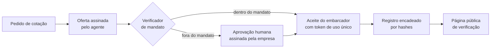

# Elo — camada de confiança entre agentes logísticos

**O problema:** Agentes de IA de frete já negociam em nome de uma empresa, mas falam
com o outro lado por canais feitos para humanos. Quando os dois lados tiverem agentes,
falta identidade verificável, um mandato que limite o que cada um pode prometer e
prova do que foi combinado.

**O que o Elo faz:**

- Dá a cada agente um certificado assinado pela empresa e um mandato com limites de valor, rotas, cargas e validade.
- Confere cada oferta assinada contra o mandato com código determinístico e manda o que sair dele para aprovação humana.
- Grava tudo num registro encadeado por hashes, que qualquer parte verifica sozinha numa página pública.
- Dá à transportadora um painel web em que a chave da organização é gerada e usada só no navegador.




*Página pública de verificação: 14 checagens independentes*

### Rodar em 6 comandos (cmd do Windows)

```bat
git clone https://github.com/rodrigolotti/Elo.git
cd Elo
python -m venv .venv
.venv\Scripts\activate.bat
pip install pydantic cryptography pytest fastapi uvicorn httpx2 tzdata
uvicorn elo.api:app
```

Abra http://127.0.0.1:8000/painel/ para usar o painel da transportadora. Ou,
num segundo `cmd` na mesma pasta, `.venv\Scripts\activate.bat` e
`python demo_api.py`: a demo imprime o link da página de verificação.

### Limitações conhecidas

- É um protótipo com dados fictícios, não usado em produção nem validado juridicamente (a assinatura Ed25519 não é ICP-Brasil).
- O aceite do embarcador é atestado pela plataforma, não assinado por ele.
- Quem controla o banco inteiro pode reescrever a corrente (falta ancoragem externa).
- Nesta versão, se a chave da organização se perder no navegador, não há como recuperá-la. A chave de recuperação é a próxima etapa.
- O agente ainda não usa IA: as ofertas vêm de um cliente de demonstração. A extração com IA é a Fase 2.

A lista completa está em [Limitações conhecidas (honestas)](#limitações-conhecidas-honestas).

---

Núcleo da V1 (Fase 1 do roadmap). Permite que o agente de IA de uma transportadora
emita ofertas de frete **assinadas**, dentro de um **mandato** definido pela empresa,
e que o embarcador aceite. Qualquer parte consegue **verificar sozinha** o que foi
combinado. Tudo fica num registro só de inclusão, com hashes encadeados.

> Dados fictícios. Este projeto não usa nenhum dado de empregador ou cliente real.

## Como rodar

Requisitos: Python 3.11+, `pydantic` 2 e `cryptography`. Para a API, `fastapi`,
`uvicorn`, `httpx2` e `tzdata` (fusos horários da página de verificação). Para os testes, `pytest`.
Os testes do JavaScript do painel usam Node 20 ou mais novo; sem Node, eles são pulados.

```bash
python3 -m venv .venv && . .venv/bin/activate
pip install pydantic cryptography pytest fastapi uvicorn httpx2 tzdata
python3 demo.py          # cenário de ponta a ponta, com tentativa de fraude no final
python3 -m pytest -q     # 185 testes (26 do núcleo + 55 da API + 104 do painel)
```

## API no Windows (cmd)

Na pasta do projeto, num Prompt de Comando (`cmd`):

```bat
:: 1. ambiente virtual e dependências (só na primeira vez)
python -m venv .venv
.venv\Scripts\activate.bat
pip install pydantic cryptography pytest fastapi uvicorn httpx2 tzdata

:: 2. testes
python -m pytest -q

:: 3. sobe a API em http://127.0.0.1:8000 (o banco fica em elo.db)
uvicorn elo.api:app --reload
```

Para usar outro arquivo de banco, antes de subir: `set ELO_DB=C:\caminho\outro.db`.

O registro fica nesse arquivo SQLite, não só na memória: ao reiniciar a API,
organizações, mandatos, ofertas e compromissos continuam lá e verificáveis. Para
começar do zero, pare a API e apague o `elo.db`.

Com a API no ar, abra **um segundo** `cmd` na mesma pasta e rode a demo do cliente:

```bat
.venv\Scripts\activate.bat
python demo_api.py
```

Ela gera as chaves da transportadora e do agente **localmente**, cadastra tudo pela
API, emite uma oferta dentro do mandato e outra acima do limite (que passa por
aprovação), aceita as duas, revoga o mandato (mostrando que a oferta seguinte já
sai dele) e imprime no final os links, por exemplo:

```
Abra no navegador:
   http://127.0.0.1:8000/verificar/cp_cb1a583ddaa9
```

Abra esse link no navegador (ou rode `start http://127.0.0.1:8000/verificar/<id>`
no `cmd`). A página mostra as 14 checagens com OK ou FALHA e o resultado final.
A documentação interativa da API fica em http://127.0.0.1:8000/docs.
O painel da transportadora fica em http://127.0.0.1:8000/painel/ (veja abaixo).
Para parar a API, use `Ctrl+C` na janela em que ela está rodando.

### Como a API assina sem receber chave privada

Toda operação que precisa da assinatura de uma empresa tem dois passos:

1. `POST /<recurso>/rascunho`: a plataforma aplica as regras e devolve o objeto
   **sem assinatura**. O rascunho fica pendente por 10 minutos.
2. O cliente assina o rascunho do lado dele e envia o objeto assinado em
   `POST /<recurso>`. A plataforma confere a assinatura contra a chave pública
   esperada (da organização ou do agente), revalida o estado e grava no registro.
   O objeto precisa ser idêntico ao rascunho: alterar qualquer campo antes de
   assinar é recusado, e o mesmo objeto assinado não pode ser enviado duas vezes.

| Rota | O que faz | Quem assina |
| --- | --- | --- |
| `POST /organizacoes/rascunho` → `POST /organizacoes` | Cadastra a organização | a própria organização |
| `POST /agentes/rascunho` → `POST /agentes` | Emite o certificado do agente | organização |
| `POST /mandatos/rascunho` → `POST /mandatos` | Emite o mandato | organização |
| `POST /mandatos/{id}/revogacao/rascunho` → `POST /mandatos/{id}/revogacao` | Revoga o mandato | organização |
| `POST /pedidos` | Registra o pedido de cotação | ninguém |
| `POST /ofertas/rascunho` → `POST /ofertas` | Emite a oferta (diz se sai do mandato) | agente |
| `POST /ofertas/{id}/aprovacao/rascunho` → `POST /ofertas/{id}/aprovacao` | Aprovação humana | organização |
| `POST /ofertas/{id}/recusa/rascunho` → `POST /ofertas/{id}/recusa` | Recusa definitiva | organização |
| `POST /ofertas/{id}/aceite` | Aceite do embarcador por link (exige o token de aceite) | plataforma (atesta) |
| `GET /compromissos/{id}/verificacao` | Relatório em JSON | — |
| `GET /verificar/{id}` | Página pública de verificação (HTML) | — |

Erros de regra respondem 400, objetos inexistentes 404 e corpo inválido 422.

### Sessão e consultas

As consultas exigem sessão, e cada sessão só enxerga os dados da própria
organização. Não há senha: entra quem tem a chave da organização.

| Rota | O que faz |
| --- | --- |
| `POST /sessoes/desafio` | Devolve um desafio (nonce aleatório) para a organização assinar. Vale 5 minutos e uma vez só |
| `POST /sessoes` | Troca o desafio assinado pela organização por um token de sessão de 30 minutos |
| `DELETE /sessoes` | Encerra a sessão |
| `GET /organizacao`, `/agentes`, `/mandatos`, `/ofertas?status=...`, `/compromissos` | Consultas da organização logada |

O token vai no cabeçalho `Authorization: Bearer <token>`, e a API guarda só o
hash dele. Sem sessão válida, a resposta é 401. Fora as duas rotas de
verificação, nenhuma rota `GET` fica aberta, e um teste percorre todas para
garantir isso.

## Painel da transportadora

Com a API no ar, abra http://127.0.0.1:8000/painel/. É HTML, CSS e JavaScript
servidos pelo próprio FastAPI, sem framework e sem etapa de build.

| Tela | O que faz |
| --- | --- |
| Entrar | Escolhe a organização guardada no navegador e entra assinando o desafio |
| Cadastro | Gera a chave da organização no navegador e cadastra o CNPJ |
| Agentes | Cria o certificado do agente a partir da chave pública dele |
| Mandatos | Define valor máximo, UFs, tipos de carga e validade, e revoga mandatos |
| Aprovações | Fila das ofertas fora do mandato, com o motivo de cada uma: aprovar ou recusar |
| Histórico | Compromissos firmados, com link para `/verificar/{id}` |

**A chave da organização nunca sai do navegador.** Ela é criada com a Web Crypto
API (Ed25519) marcada como **não exportável** e guardada no IndexedDB como
`CryptoKey`: nem o painel consegue ler os bytes dela. Para o servidor vão só a
chave pública e os objetos assinados. Funciona no Chrome e no Edge 137 ou mais
novos, no Firefox 129 ou mais novo e no Safari 17 ou mais novo.

**O painel confere antes de assinar.** Cada rascunho devolvido pela API precisa
ter exatamente os campos que a pessoa escolheu (a oferta que está na tela, os
limites digitados, a chave colada). Se vier diferente, nada é assinado. Assim o
servidor não consegue fazer a organização assinar outra coisa.

**A assinatura feita no navegador bate com a do servidor.** `elo/painel/js/canonico.js`
faz a mesma canonicalização de `elo/canonico.py`. Os testes rodam esses mesmos
módulos no Node e comparam os bytes com o Python, incluindo acentos, emoji,
caracteres de controle e a ordenação por unidades UTF-16. Depois provam que
assinaturas feitas em JavaScript são aceitas pela API. Um inteiro acima de 2^53
é recusado no navegador, porque o JavaScript o arredondaria sem avisar.

**Se o navegador perder a chave.** Isso acontece ao limpar os dados do site,
trocar de computador, usar janela anônima ou, no Safari, ficar 7 dias sem abrir
o painel. Sem a chave, a organização não cria agentes, não emite mandatos, não
aprova nem recusa ofertas e **não consegue revogar mandatos**. Os compromissos
já firmados continuam válidos. Nesta versão não há recuperação, e a tela de
cadastro avisa disso. A próxima etapa traz uma chave de recuperação guardada
fora do navegador.

### Verificação num Chrome de verdade

```bat
node tests\e2e\painel_chrome.mjs C:\caminho\para\capturas
```

O roteiro sobe a API com um banco temporário e abre o Chrome (ou o Edge) headless
com um perfil vazio. Ele percorre todas as telas e faz também o papel do agente
e do embarcador. No caminho, confere:

- se a chave no IndexedDB está como `extractable: false`;
- se houve algum erro de console ou de CSP;
- se algum corpo enviado ao servidor levou chave privada.

As capturas de tela vão para a pasta informada. Use `CHROME` para indicar outro
navegador e `PYTHON` para outro interpretador. Ele fica fora do `pytest` porque
precisa de um navegador instalado.

### Token de aceite

Ao registrar a oferta (`POST /ofertas`), a resposta traz `token_aceite`, gerado
com `secrets.token_urlsafe(32)`. **Ele aparece só nessa resposta**: o registro
guarda apenas o hash SHA-256 (`token_aceite_hash`). A transportadora manda o token
ao embarcador junto com o link, e o aceite precisa dele:

```json
POST /ofertas/{id}/aceite
{"token": "<token_aceite>", "cnpj": "22.333.444/0001-xx", "nome": "Maria", "email": "maria@exemplo.com"}
```

Sem token o pedido é recusado (422). Token errado ou de outra oferta também
(400, "token de aceite inválido"), e o token é conferido antes de tudo, então
não revela nada sobre a oferta. Como cada oferta só pode ser aceita uma vez, o
token é de uso único: reenviá-lo depois do aceite é recusado.

## O que já funciona

- Cadastro de organização por CNPJ (com dígitos verificadores) e chave Ed25519 própria.
- Certificado do agente, assinado pela chave da organização.
- Mandato assinado: valor máximo, UFs de origem e destino, tipos de carga e validade. Pode ser revogado (revogação também assinada pela organização). A revogação vale pela ordem do registro: ofertas registradas antes dela continuam autorizadas, as registradas depois saem do mandato, mesmo que caiam no mesmo segundo.
- Oferta assinada pelo agente. Se ela sair do mandato, fica aguardando aprovação humana.
- Aprovação humana assinada com a chave da organização, ou recusa definitiva, também assinada e gravada no registro. Uma oferta recusada não pode mais ser aprovada nem aceita.
- Aceite do embarcador por link, atestado pela plataforma. Exige o token de aceite de uso único gerado na emissão da oferta. Só o destinatário pode aceitar, só dentro da validade e uma vez só.
- Registro SQLite só de inclusão: os gatilhos recusam UPDATE e DELETE, e a corrente de hashes denuncia adulteração direta no arquivo.
- Relatório de verificação com 14 checagens independentes, refeitas a partir do registro.
- API HTTP (FastAPI) em que as empresas assinam do lado delas: a API nunca recebe chave privada.
- Página pública `/verificar/{id}`, em português, com as 14 checagens (OK ou FALHA) e o resultado final.
- Registro persistido no arquivo de `ELO_DB` (padrão `elo.db`): compromissos continuam verificáveis depois de reiniciar a API.
- Login no painel por desafio assinado com a chave da organização. As consultas exigem sessão e mostram só os dados da própria organização.
- Painel web da transportadora em `/painel`: cadastro, agentes, mandatos com revogação, fila de aprovação e histórico, com a chave da organização só no navegador.

## Estrutura

| Arquivo | Responsabilidade |
| --- | --- |
| `elo/canonico.py` | JSON canônico (subconjunto da RFC 8785) e SHA-256 |
| `elo/chaves.py` | Geração de chaves, assinatura e verificação Ed25519 |
| `elo/cnpj.py` | Validação e formatação de CNPJ |
| `elo/modelos.py` | Formatos validados: carga, condições, limites do mandato |
| `elo/mandato.py` | Regras do mandato (código puro, sem IA) |
| `elo/registro.py` | Registro de eventos com hashes encadeados |
| `elo/servico.py` | Fluxo completo e verificação de compromissos |
| `elo/sessoes.py` | Login por desafio assinado e sessões do painel |
| `elo/api.py` | API HTTP, página de verificação e entrega do painel (sem regra de negócio) |
| `elo/painel/` | Painel web: `index.html`, `estilo.css` e os módulos em `js/` |
| `elo/painel/js/canonico.js`, `assinatura.js` | Canonicalização e assinatura Ed25519 no navegador, compatíveis com o Python |
| `elo/painel/js/cofre.js` | Guarda a chave não exportável no IndexedDB |
| `elo/painel/js/conferencia.js` | Confere o rascunho antes de assinar |
| `tests/js/navegador_node.mjs` | Roda os módulos do painel no Node para os testes de compatibilidade |
| `tests/e2e/painel_chrome.mjs` | Percorre o painel num Chrome headless |
| `demo_api.py` | Cliente de demonstração: gera as chaves localmente e chama a API |

## Decisões de projeto

- **Sem números com casa decimal.** Valores em centavos, peso em kg e volume em litros, sempre inteiros. Isso elimina erro de arredondamento e mantém a canonicalização simples. O canonicalizador recusa `float`.
- **A plataforma não guarda nem recebe as chaves privadas das empresas.** Ela prepara o rascunho, a empresa assina do lado dela e devolve o objeto assinado. A chave da própria plataforma (usada para atestar aceites) é gerada a cada início da API e fica só na memória; a parte pública vai para o registro, então aceites antigos continuam verificáveis.
- **O registro é a fonte da verdade.** O estado em memória é reconstruído a partir dele, e a verificação sempre relê o registro.
- **A chave da organização mora no navegador, e o painel não assina às cegas.** Ela é criada não exportável, e cada rascunho é conferido antes da assinatura. A página tem CSP só com script e estilo do próprio servidor, e nenhum dado vindo da API é interpretado como HTML. Um XSS poderia usar a chave enquanto a página estivesse aberta (não copiá-la), então a defesa é não deixar script estranho rodar.
- **Login sem senha.** Entrar no painel é assinar um desafio com a chave da organização. Desafios e sessões não são atos do protocolo: ficam na memória, fora do registro.
- **A regra do mandato é código determinístico.** Quando o agente com IA chegar (Fase 2), ele só vai extrair dados. Um e-mail malicioso não consegue mudar o que o código autoriza.

## Limitações conhecidas (honestas)

- **O aceite por link é atestado pela plataforma, não assinado pelo embarcador.** É mais fraco que uma assinatura própria. A V2 deve oferecer chave ao embarcador ou integração com ICP-Brasil.
- **Quem controla o banco inteiro pode reescrever a corrente toda.** A defesa é publicar periodicamente o hash mais recente num lugar externo (ancoragem). Ainda não está implementado.
- **A existência do CNPJ na Receita não é consultada**, só os dígitos verificadores.
- **Validade jurídica:** a assinatura Ed25519 própria não é certificado ICP-Brasil. Antes de um piloto real, valide com um advogado.
- **Desempenho:** a verificação relê o registro inteiro. Isso basta para a V1, mas exige índices e snapshots em escala.
- **As consultas exigem sessão, mas as rotas de escrita não.** O que importa é protegido por assinatura (organização e agente) ou pelo token de aceite, mas qualquer um consegue, por exemplo, registrar pedidos ou pedir rascunhos. Os desafios de login têm teto de 5 pendentes por organização: passou disso, o mais antigo é descartado.
- **`POST /pedidos` não exige assinatura nem sessão.** Qualquer pessoa consegue registrar pedidos de cotação em nome de qualquer CNPJ, e cada pedido entra no registro, que só cresce. Antes de ir para a internet, essa rota precisa de proteção: autenticação de quem envia (o canal de entrada ou o embarcador), limite de requisições e de tamanho.
- **Perder a chave da organização no navegador é irreversível nesta versão.** A chave de recuperação vem na próxima etapa.
- **Zerar bytes em memória no JavaScript é melhor esforço, não garantia.** O painel zera com `fill(0)` a chave de recuperação em PKCS#8 depois de cifrá-la ou de importá-la, mas o motor JavaScript e a Web Crypto podem ter feito cópias internas que o código não alcança, e a frase-senha é uma string, que não pode ser zerada. A proteção real é a chave principal ser não exportável e a de recuperação só existir em claro por um instante.
- **O navegador pode negar o armazenamento persistente.** Nesse caso ele pode apagar o IndexedDB se faltar espaço, e o painel avisa quando isso acontece.
- **Sessões ficam na memória.** Se a API reiniciar, é preciso entrar de novo no painel.
- **O token de aceite é um segredo ao portador.** Quem tiver o token e o CNPJ do destinatário consegue aceitar. A transportadora precisa mandá-lo só ao embarcador, por um canal confiável.
- **Rascunhos pendentes ficam na memória.** Se a API reiniciar, o rascunho que ainda não foi assinado se perde e é preciso preparar de novo.
- **A API atende uma requisição por vez** (uma trava em volta da plataforma). Basta para a V1.

## Próximos passos

1. Chave de recuperação da organização e rotação de chave registrada no protocolo.
2. Página HTML de aceite para o embarcador.
3. Ancoragem periódica do hash do registro.
4. Fase 2: extrator com IA (só extração, saída estruturada) e motor de preço por tabela.
